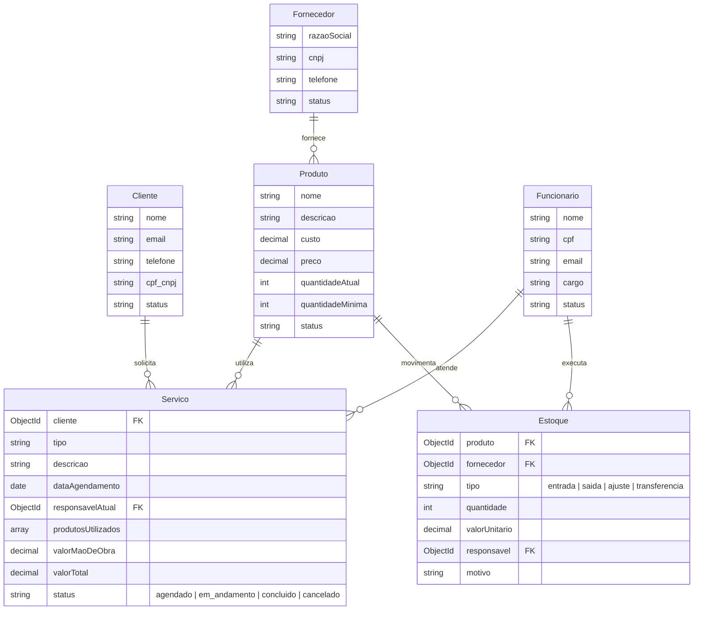

# Sistema de Gerenciamento de Serviços (Showcase)

Showcase público higienizado de uma aplicação full stack para gestão operacional de motores elétricos, controle de clientes, produtos, fornecedores, funcionários, movimentações de estoque e ordens de serviço.

Originalmente desenvolvido como projeto prático na disciplina de Engenharia de Software no IFBA utilizando metodologia Scrum.

---

## Escopo do Showcase e Contribuição

Este repositório é uma demonstração pública e higienizada do sistema.

### Equipe do projeto original
- Allisson de Almeida Bento Viana
- Dimitri Alves Andrade Freitas
- Eduardo de Carvalho Reis
- Kauê Santos Fernandes

### Minhas contribuições principais ([Kauê Fernandes](https://github.com/fernandes-kaue))
- **Módulos do Backend**: arquitetura e extensão das rotas REST e controllers usando Express e Mongoose.
- **Módulo de Serviços**: modelagem e fluxo completo de ordens de serviço, associação de técnicos responsáveis, histórico de atendimentos e cálculo de custos de mão de obra e peças.
- **Validações de Estoque**: regras de negócio para transações e movimentações (entradas, saídas, ajustes e transferências), impedindo saídas sem saldo suficiente.
- **Integração Full Stack**: padronização do cliente HTTP no frontend, tratamento centralizado de erros de rede/abort de requisições e refinamento dos formulários de edição com preenchimento reativo.

---

## Arquitetura e Modelagem



---

## Tecnologias

- **Backend**: Node.js, Express 5, MongoDB, Mongoose, dotenv
- **Frontend**: React 19, Vite, React Router DOM 7, ESLint
- **Infraestrutura local**: Docker Compose (MongoDB), Concurrently
- **Protocolo de Comunicação**: REST / JSON via cliente `fetch` customizado com proxy reverso local no Vite

---

## Execução local

### Pré-requisitos
- Node.js (versão 20 ou superior)
- npm
- Docker e Docker Compose (opcional, para rodar o MongoDB localmente)

### 1. Clonar o repositório
```bash
git clone https://github.com/fernandes-kaue/sistema-gerenciamento-servicos-showcase.git
cd sistema-gerenciamento-servicos-showcase
```

### 2. Subir o MongoDB local
```bash
docker compose -f compose.example.yaml up -d
```
O banco MongoDB estará disponível em `127.0.0.1:27017`.

### 3. Configurar variáveis de ambiente
No backend:
```bash
cp backend/.env.example backend/.env
```
*(O arquivo padrão já aponta para `mongodb://127.0.0.1:27017/sistema_servicos`)*

### 4. Instalar dependências e iniciar
Na raiz do projeto:
```bash
npm install
npm --prefix backend install
npm --prefix frontend install
npm run dev
```

- **Frontend**: `http://localhost:5173`
- **Backend API**: `http://localhost:3000`

---

## Decisões de Regra de Negócio

1. **Gestão de Estoque**: saídas de estoque validam o saldo disponível do produto no banco antes da persistência, impedindo registros com estoque negativo.
2. **Ciclo de Vida de Serviços**: o cancelamento ou inativação de serviços preserva o histórico de responsáveis técnicos e os insumos alocados para auditoria.
3. **Inativação Lógica**: clientes, fornecedores e funcionários utilizam flags de status (`ativo`/`inativo`), evitando deleções em cascata acidentais de registros vinculados a serviços passados.
4. **Isolamento de Ambiente**: a API utiliza variáveis de ambiente estritas com encerramento precoce caso a `MONGO_URI` não esteja definida na inicialização.

---

## Limitações do Showcase

- Não inclui dados reais de clientes, empresas ou credenciais de produção.
- Não inclui strings de conexão de clusters em nuvem privados.
- Focado na demonstração arquitetural, modelagem e código funcional.

---

## Licença

Distribuído sob a licença GNU General Public License v3.0 ([GPL-3.0](./LICENSE)).
